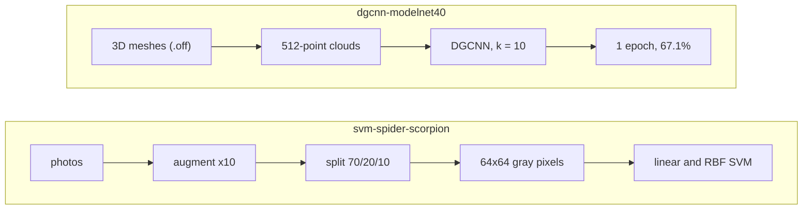

# ML Learning Notes

Two small experiments from coursework and self-study, kept as honest learning notes rather than finished projects. Each one has its own pipeline diagram, results, and a list of what is wrong or missing.

| Project | Question | Data | Result as logged | Status |
|---|---|---|---|---|
| [`svm-spider-scorpion`](svm-spider-scorpion) | How far do plain pixels and an SVM get on spider vs scorpion photos? | Kaggle, 600 original photos | linear 80.7%, RBF **89.3%** (optimistic, see notes) | finished baseline |
| [`dgcnn-modelnet40`](dgcnn-modelnet40) | Can a DGCNN classify 3D shapes (ModelNet40) when Colab time is short? | ModelNet40, 12,311 meshes | **67.1%** test accuracy after one epoch | trained one epoch; ensemble unfinished |



## What I took from them

- Augmenting **before** splitting leaks near-copies into the test set. The SVM numbers show it; the planned fix is to split the originals first.
- A model that learns neighbourhoods of points (EdgeConv) trains well even in one epoch, but one epoch is far from the roughly 92% the DGCNN paper reports with a long schedule.
- Data hygiene matters as much as the model: ModelNet40's `.off` files need a header repair before Open3D can read them.

## Layout

```
svm-spider-scorpion/   notebook, figures, data notes, requirements.txt
dgcnn-modelnet40/      notebook, trained weights (6.9 MB), metadata CSV, figures, data notes, requirements.txt
```

Datasets are not redistributed; each project's `data/README.md` says where to get them. Notebook paths are Google Colab paths (`/content/drive/MyDrive/...`). License: [MIT](LICENSE) for the code and write-ups; the DGCNN weights were trained on ModelNet40, so check that dataset's terms before using them for anything else.
