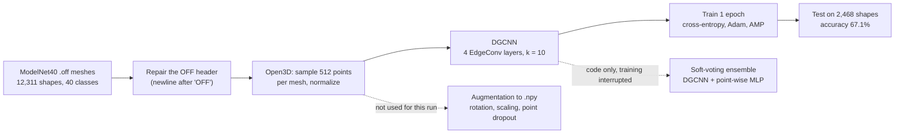
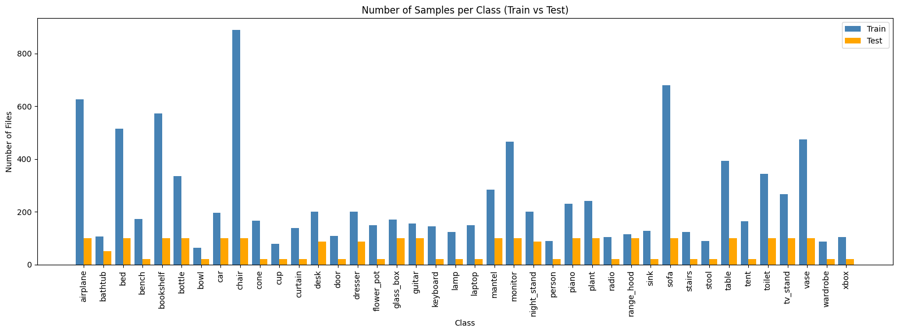
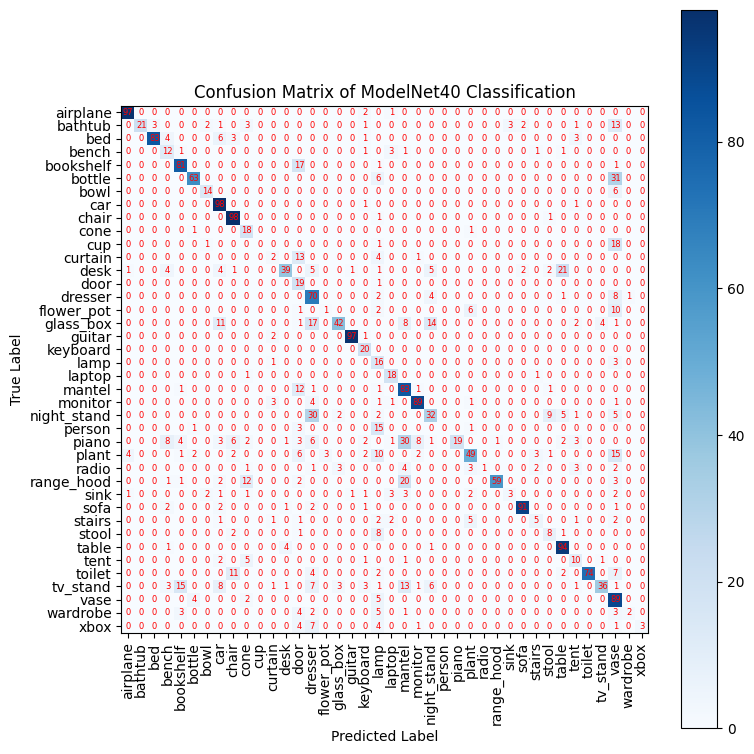

# DGCNN on ModelNet40 (3D point-cloud classification)

Classify 3D shapes from 40 object categories with a **Dynamic Graph CNN**, trained from scratch in Google Colab. The runtime budget allowed **one epoch**, so this is a working pipeline and an honest first result, not a tuned model.


| | |
|---|---|
| Data | ModelNet40: 12,311 shapes, 40 classes, 9,843 train / 2,468 test (official split) |
| Input | 512 points sampled from each mesh, normalized to [-1, 1] |
| Model | DGCNN, 4 EdgeConv layers (k = 10), 1,024-d global feature, MLP 512-256-40 |
| Training | **1 epoch**, Adam (lr 1e-3, weight decay 1e-4), mixed precision, batch 16: train accuracy 57.7% |
| Result | **67.1% test accuracy** (2,468 shapes) |

## Pipeline



How DGCNN sees a shape: for every point it finds the `k` nearest neighbours **in feature space**, builds edge features (the point and its offsets to those neighbours), applies a shared MLP and max-pools over the neighbours; the neighbour graph is rebuilt at every layer, hence "dynamic".

<table>
<tr>
<td align="center"><b>Class balance (train vs test)</b><br></td>
<td align="center"><b>Test confusion matrix after 1 epoch</b><br></td>
</tr>
</table>

## What the result says

- The data is imbalanced (889 chair shapes against 64 bowls in training), and with one epoch the model favours big classes. In the confusion matrix several container-like classes (bottle, cup, bathtub, flower pot) are predicted as `vase`.
- 67.1% after one epoch is far from the roughly 92% the DGCNN paper (Wang et al., 2019) reports with 1,024 points and a long schedule; the gap is mostly training time, not the idea.
- No hyper-parameter search, learning-rate schedule or augmentation was used for this run.

## Honest notes

1. **512 points, not 1,024.** The first plan used 1,024 points per shape; training did not fit in the Colab runtime, so the model was trained on 512 (the weights file is named `dgcnn_model_512.pth`). The augmentation step still writes 1,024-point `.npy` files.
2. **The "PointNet++" in the ensemble is not PointNet++.** The class `PointNetPlusPlus_768` is a point-wise MLP with pooling (no set-abstraction layers), so it is closer to a plain PointNet. The two-model soft-voting code was written but training was interrupted (`KeyboardInterrupt`), so no ensemble result exists.
3. **The `.off` files need a header repair.** Official ModelNet40 files put `OFF` and the counts on one line (`OFF6360 10283 0`), which Open3D cannot read; the notebook's `fix_off_header` rewrites each file in place with a newline after `OFF`. See [`data/README.md`](data/README.md).
4. Training accuracy (57.7%) is computed while the model is still learning during the epoch, so it understates the model's final training fit.

## Files

```
notebooks/dgcnn_modelnet40.ipynb   the experiment (48 cells, outputs kept)
models/dgcnn_model_512.pth         trained weights (state_dict, 6.9 MB)
data/metadata_modelnet40.csv       object id, class, split and path of all 12,311 shapes
data/README.md                     where the data comes from and the header quirk
docs/figures/                      class balance, confusion matrix, a sample point cloud
```

Load the weights with `torch.load("models/dgcnn_model_512.pth", map_location="cpu", weights_only=True)` into the `DGCNN(num_classes=40, k=10)` class defined in the notebook.

## Run

[](https://colab.research.google.com/github/Taiga0727/ml-learning-notes/blob/main/dgcnn-modelnet40/notebooks/dgcnn_modelnet40.ipynb)

1. Open `notebooks/dgcnn_modelnet40.ipynb` in Google Colab with a GPU runtime.
2. Put your `kaggle.json` at `MyDrive/kaggle.json`; the notebook downloads ModelNet40 from Kaggle (about 1.9 GB) and unzips it to `MyDrive/Pointnet/ModelNet40`.
3. Run the cells in order. Paths are Colab paths.

## Credits

The EdgeConv helpers `knn` and `get_graph_feature` and the layer layout follow the reference implementation of Wang et al., *Dynamic Graph CNN for Learning on Point Clouds* (ACM Transactions on Graphics, 2019): [WangYueFt/dgcnn](https://github.com/WangYueFt/dgcnn), MIT licence, Copyright (c) Massachusetts Institute of Technology and its affiliates. ModelNet40 is from Wu et al., *3D ShapeNets: A Deep Representation for Volumetric Shapes* (CVPR 2015).
