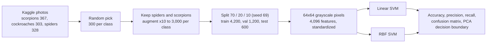
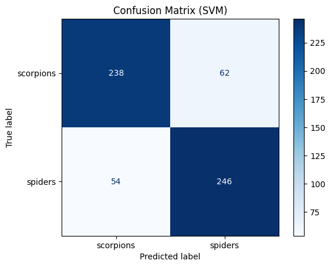
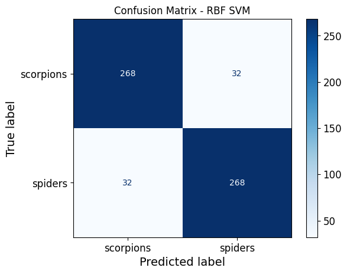

# SVM on Spider vs Scorpion Photos

A classical-ML baseline: flatten small grayscale images into pixel vectors and compare a **linear** and an **RBF** support-vector machine.

| Model | Accuracy (600 test images) | Precision / recall |
|---|---|---|
| Linear SVM (`C = 1`) | **80.67%** | scorpions 0.82 / 0.79, spiders 0.80 / 0.82 |
| RBF SVM (`C = 5`, `gamma = scale`) | **89.33%** | 0.89 / 0.89 for both classes |

[Pipeline](#pipeline) · [Limitations](#limitations) · [Run](#run)

## Pipeline

<table>
<tr>
<td align="center"><b>Linear SVM</b> </td>
<td align="center"><b>RBF SVM</b> </td>
</tr>
</table>

The 4,096-dimensional features are projected to 2D with PCA only to draw the decision boundaries ([`docs/figures/`](docs/figures)). The RBF boundary is curved where the linear one cannot be, which matches the 8.7-point gain, but two PCA axes are a very lossy view of 4,096 dimensions: the plots illustrate, they are not evidence.

## Limitations

1. **Augmentation happens before the split.** 600 original photos (300 per class) become 6,000 augmented images and are split afterwards, so augmented variants of one photo sit in train, validation and test and the accuracies are optimistic. Fix: split the 600 originals first and augment only the training part.
2. **No tuning loop.** The validation set is merged into training for the final fit, and `C = 1` and `C = 5` were set by hand, without cross-validation.
3. **The cockroach class is downloaded and sampled but unused;** the task is binary.
4. **Pixels are a weak feature** for photos taken from different angles and backgrounds. A pretrained CNN embedding with the same SVM is the obvious next step.

## Run

1. Open `notebooks/svm_classification.ipynb` in Google Colab (badge above).
2. The notebook downloads the dataset with `kagglehub` ([`data/README.md`](data/README.md)) and builds its working folders under `MyDrive/SVM/`.
3. Run the cells in order. Paths are Colab paths. Libraries: `requirements.txt`.
